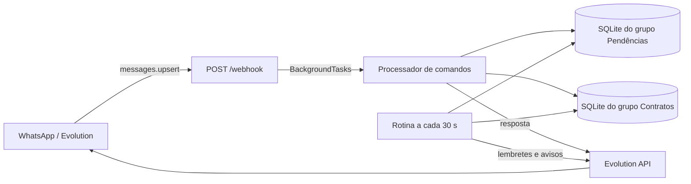

# Visão geral da arquitetura

## Objetivo observado

A aplicação mantém listas de pendências por cliente, recebe comandos de grupos do WhatsApp por um webhook da Evolution API e responde no grupo de origem. Também agenda lembretes por tarefa e avisos recorrentes para clientes de contrato. A aplicação está implementada principalmente em [`app_pendencias.py`](../../../app_pendencias.py).

## Componentes

| Componente | Responsabilidade | Referência |
|---|---|---|
| Configuração | Lê `.env`, resolve caminhos e exige dois JIDs de grupo distintos e dois bancos distintos. | [`app_pendencias.py`](../../../app_pendencias.py#L16) |
| Aplicação HTTP | FastAPI fornece `POST /webhook`; Uvicorn é iniciado diretamente pelo script. | [`app_pendencias.py`](../../../app_pendencias.py#L283), [`app_pendencias.py`](../../../app_pendencias.py#L1157) |
| Motor de comandos | Interpreta comandos recebidos e coordena as operações de pendências e as respostas. | [`app_pendencias.py`](../../../app_pendencias.py#L833) |
| Persistência | SQLite, com um caminho por grupo e tabelas de tarefas e avisos de contrato. | [`app_pendencias.py`](../../../app_pendencias.py#L347) |
| Envio externo | `requests` chama a Evolution API para enviar texto. | [`app_pendencias.py`](../../../app_pendencias.py#L679) |
| Agendador | Uma tarefa do ciclo de vida FastAPI verifica lembretes e avisos a cada 30 segundos. | [`app_pendencias.py`](../../../app_pendencias.py#L259), [`app_pendencias.py`](../../../app_pendencias.py#L1133) |

O diagrama representa as ligações observadas no código; a configuração real do serviço Evolution e do WhatsApp precisa ser fornecida pelo ambiente operacional.

## Limites e decisões observadas

- Há exatamente dois grupos permitidos. Os JIDs vêm de `JID_PENDENCIAS` e `JID_CONTRATOS`; os caminhos de banco são distintos e associados ao grupo por `GRUPOS`.
- A função de envio recusa destinos que não estejam em `GRUPOS`.
- O webhook ignora chats não configurados, mensagens sem texto e mensagens sem o prefixo `!`.
- A aplicação registra IDs de mensagens enviadas em memória para não processar respostas do próprio bot como novos comandos.
- Não há separação de pacotes: a maior parte do comportamento está em um módulo Python.
- Inferência operacional: rodar mais de um processo pode duplicar verificações e envios. O código não implementa eleição de líder ou bloqueio distribuído.

Detalhes: [[01 - Arquitetura/Configuracao|configuração]], [[04 - Dados/Modelo SQLite|persistência]], [[03 - Fluxos/Recepcao e comandos|comandos]] e [[07 - Operacao/Execucao e operacao|operação]].

Voltar para [[01 - Arquitetura/Indice|índice de arquitetura]].
