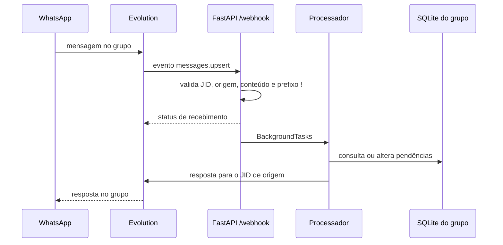

# Recepção e processamento de comandos

## Etapas confirmadas

1. `receber_webhook` lê JSON e aceita apenas o formato de evento `messages.upsert` com estruturas `data` e `key` válidas.
2. Compara `remoteJid` com os dois JIDs configurados; outros chats são descartados antes do processamento textual.
3. Quando `fromMe` é verdadeiro, ignora somente IDs que estão registrados como enviados pelo bot. Mensagens digitadas manualmente pelo mesmo número podem ser processadas.
4. Extrai texto dos campos de mensagem suportados; se não houver texto útil, retorna `sem_texto`.
5. Exige o prefixo `!`, remove esse prefixo e agenda `processar_comando_whatsapp` com `BackgroundTasks`.
6. O processador seleciona o SQLite correspondente ao grupo e, conforme o comando, consulta, grava, remove ou confirma dados.
7. Respostas são enviadas ao mesmo JID, mediante a Evolution API.

Os valores de status retornados pelo endpoint são códigos de resultado simples, não documentação de um contrato formal de webhook. Veja a rota em [`app_pendencias.py`](../../../app_pendencias.py#L1157) e a integração em [[05 - Interfaces e Integracoes/Webhook e Evolution API|Webhook e Evolution API]].

Voltar para [[03 - Fluxos/Indice|índice de fluxos]].
