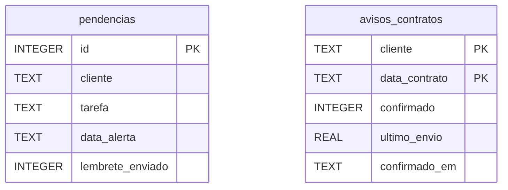

# Modelo SQLite

O sistema mantém um arquivo SQLite para cada grupo configurado. No padrão, os caminhos são `pendencias.db` para Pendências e `contratos.db` para Contratos, resolvidos relativamente à pasta do aplicativo. Ambos são inicializados com as duas tabelas por `inicializar_banco`; a rotina não apaga dados existentes.

## `pendencias`

Definida em [`app_pendencias.py`](../../../app_pendencias.py#L347).

| Campo | Tipo/uso |
|---|---|
| `id` | Chave primária inteira autoincremental; também determina a ordem da lista. |
| `cliente` | Texto obrigatório; a aplicação grava o cliente em minúsculas. |
| `tarefa` | Texto obrigatório com a descrição da pendência. |
| `data_alerta` | Texto opcional no formato `YYYY-MM-DD HH:MM`. |
| `lembrete_enviado` | Inteiro, padrão `0`; passa a `1` depois de envio aceito. |

Não há chave estrangeira entre clientes e tarefas: cliente é armazenado como texto.

## `avisos_contratos`

Também definida por `inicializar_banco`, mas usada pela agenda no banco associado ao grupo Contratos.

| Campo | Tipo/uso |
|---|---|
| `cliente`, `data_contrato` | Chave primária composta que identifica a ocorrência do cliente naquele dia. |
| `confirmado` | Inteiro, padrão `0`; indica se os avisos daquela ocorrência foram confirmados. |
| `ultimo_envio` | Timestamp Unix em `REAL`; controla a repetição de 10 minutos. |
| `confirmado_em` | Texto com data/hora ISO da confirmação. |

## Isolamento e cuidados

O JID identifica o banco que as operações de comando usam. Listagem, exclusão e lembretes operam no arquivo específico do grupo; portanto, comandos do grupo Pendências não consultam o banco de Contratos.

[`deletar.py`](../../../deletar.py) é um script separado com conexão fixa a `pendencias.db` e exclusão de todas as linhas cujo cliente seja `studio home`. Ele não é chamado pela aplicação. Não o execute sem confirmar o diretório e o banco de destino.

Voltar para [[04 - Dados/Indice|índice de dados]] · Ver [[02 - Modulos/Persistencia de pendencias|operações SQLite]].
